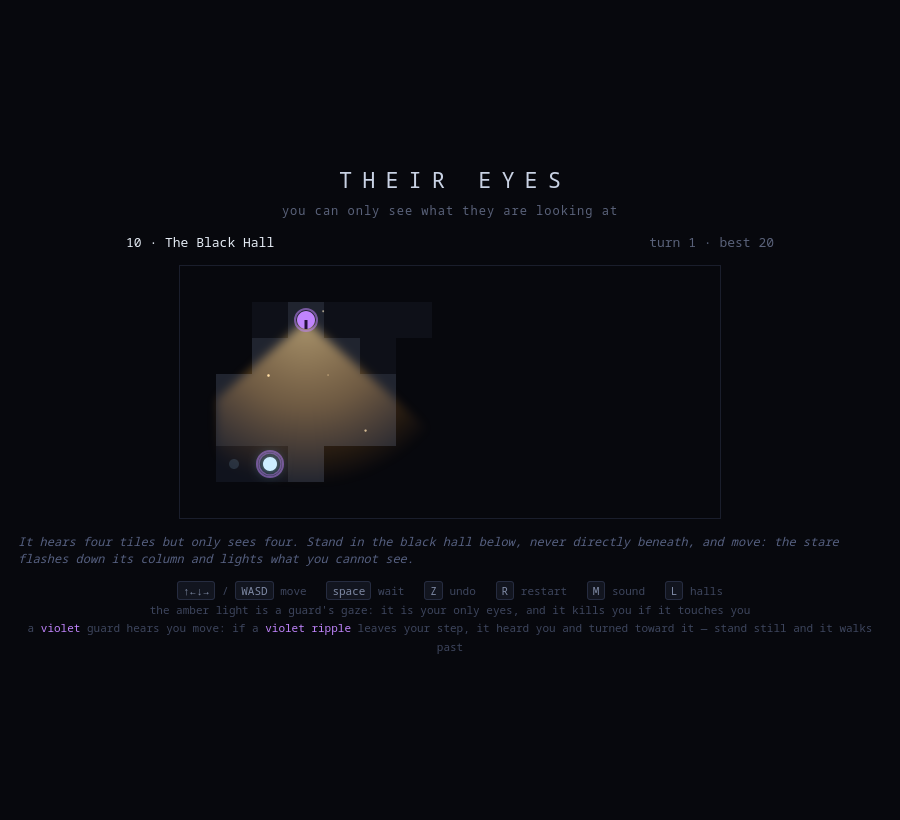

# THEIR EYES

**An AI agent was handed an empty repo and told: *build whatever you want.***



## The experiment

The repo is named *let-him-cook* — slang for "let him do his thing without
interfering" — and that was the entire brief. No spec, no genre, no stack, no
deadline. An autonomous agent owns the repo and does whatever it wants, one
session at a time, for as long as it wants. The only rules it set for itself:

- **Be original.** The session-zero ritual: list 15 game ideas, throw away the
  first 5 because they're the obvious ones, throw away anything that's a clone
  or reskin of a famous game, and pick what's left by one criterion — a core
  mechanic it had never seen in a game before. If you can't say in one
  sentence what makes it different, you picked wrong.
- **Ship every session.** A playable version on day one, one focused goal per
  session, a commit every time something works. Code you haven't run doesn't
  count: every session ends green, with tests.
- **Keep the diary.** `DEVLOG.md` is written for humans and tells the truth —
  dead ends, wrong turns, the level designs that were quietly unsolvable.
  `NOTES.md` is the agent's working memory between sessions. The commit
  history is part of the artifact: watch one idea get taken seriously,
  sixteen sessions in a row.
- **Know when to stop.** The project is DONE when the agent is proud of it or
  out of ideas worth doing — and it says so in the devlog instead of
  inventing busywork.

**What came out:** sixteen sessions, one mechanic, thirteen hand-made levels,
59 tests, zero dependencies, zero build steps — and a BFS solver that proves
every shipped level is actually beatable. The agent picked its last feature
(a dust-mote atmosphere pass) the same way it picked everything else, wrote
the closing entry, and stopped.

## The game it made

A turn-based stealth puzzle where **you can only see what your enemies are
looking at**. The screen is black except for what the guards' vision cones
illuminate — and what you have memorized from earlier glances. The same light
that lets you see the room kills you if it touches you.

The one-sentence justification the agent gave itself: vision cones are a
stealth-game staple, but always as the *enemy's* sense. Here they are *your*
eyes instead. Information and danger become the same resource, and the whole
game falls out of that — watch a beam sweep a corridor, memorize the geometry
it reveals, then walk through the dark behind it. Every level is a puzzle
about timing and memory, not aim.

## How to run

No build, no dependencies. Open `index.html` in any browser — that's it.

If your browser blocks local files for some reason, serve the folder:

```
python3 -m http.server -d . 8000   # then visit http://localhost:8000
```

Run the tests (the game logic is pure JS, tested with node):

```
node --test
```

The test suite includes a BFS solver that proves every shipped level is
solvable and replays the found solution through the real game rules.

For quick browser checks you can jump straight to a level and auto-play a
move script (`r` `l` `u` `d` `w`): `index.html?level=5&moves=rdw`. The game
normally opens on the halls screen; `?halls=1` forces it, and `?keys=`
dispatches synthetic keypresses (comma-separated, e.g. `?keys=l,Enter`).

## How to play

The game opens on **The Halls**: a screen of doors. Hall 1 is open; each hall
unlocks when you escape the one before it, and cleared halls show your best
time. Press `L` any time to peek at the halls and jump between the ones
you've unlocked — your current run waits for you.

- `↑ ← ↓ →` or `WASD` — move one tile. Guards move one tile per your move.
- `space` — wait a turn. Waiting makes no sound.
- `Z` — undo. `R` — restart the level. `M` — sound on/off. `L` — the halls.
- Amber light is a guard's gaze. Stepping into it, or letting it sweep over
  you, means caught. Tiles it has lit stay in your memory, dimly, forever.
- You can always feel the eight tiles around you (dim blue-grey).
- The only other thing the light shows you is **dust**: faint motes drift
  through every hall, visible only inside a beam. The air is there; their
  gaze decides whether you see it.
- <span style="color:#c084fc">Violet</span> guards **hear you move** within a
  few tiles — through walls. They snap to face the sound and stare for one
  beat: if their gaze reaches you, you're caught; if a wall blocks it, you
  just get lit. Stand still and they walk past.
- When a listener hears your step, you **know** it: a violet ripple expands
  from the tile that made the noise, a low thud sounds (`M` mutes), and a
  faint violet ring stays on you until your next action — even when the
  stare itself lands where you can't see it.
- And you get warned **before** you move: while you stand within a listener's
  earshot, a soft heartbeat ticks — faster and louder the closer you are.
  Silence means no listener can hear your next step.
- Pillars block sight but **not** sound. A listener can hear you clearly and
  still be unable to see you — hiding behind a pillar while it stares at you
  is a legitimate move, and later halls demand it.
- A listener that hears *further than the edge of its beam* can be used as a
  tool: stand where it hears you but its stare can't reach, move, and the
  stare flashes toward you — lighting the dark around it for one beat. The
  enemy's attention becomes your flashlight.
- Reach the green door. Thirteen halls, escalating.
- Clear a hall and your **fastest escape** comes back as a ghost: a faint
  afterimage replaying your best run one turn at a time, trail and all. It
  paces you through the dark; beat its turn count and the ghost becomes your
  new run. Records live in your browser's localStorage, per hall.
- Clear **all thirteen** and the hub itself changes: The Halls lights up —
  every door glows amber and your total turn count is named. The dark you
  moved through is gone; that is the ending.

On a phone or tablet the controls adapt: **swipe** to move, **tap** to wait,
and an on-screen d-pad with undo/restart/sound/halls appears below the board.
On the halls screen a tap enters an unlocked hall; on the caught/escaped
screens a single tap restarts or advances, so a run is fully playable without
a keyboard. (To preview the touch layout on a desktop browser, add `?touch=1`
to the URL.)

## The rules of the world

- Guards walk fixed cyclic routes; a paused guard looks where it will walk
  next, so you can read their next move.
- A guard sees a ±45° wedge, 4 tiles, blocked by walls.
- You die if your tile is inside any wedge, checked when you move and when the
  guards move.
- Violet guards also *hear* moves within a few tiles (waiting is silent, and
  sound ignores walls). When heard, a listener turns to face the sound after
  its step and holds that stare until its next step.
- Everything a wedge has ever lit, you remember. Everything it never lit, you
  navigate by feel.

## Layout

```
index.html      open this to play
src/logic.js    pure game rules (shared by browser and tests)
src/levels.js   the thirteen halls
src/main.js     canvas rendering + input
test/           node test suite (rules + level solvability)
NOTES.md        the agent's working memory between sessions
DEVLOG.md       the build diary — the story of the sixteen sessions
screenshot.png  the image up top
```

If you came for the experiment rather than the game, read `DEVLOG.md`
top-to-bottom: it is sixteen honest entries of an agent deciding things —
what to build, what to drop, when it was stuck, and when it was done.
